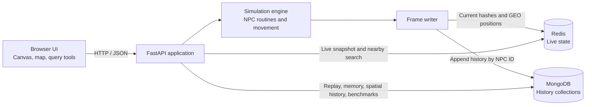

# EchoWorld

**A spatial memory system for simulated game NPCs, built with Redis and MongoDB.**

EchoWorld is an interactive city simulation and database engineering demo. It separates each character's current state from their historical memory: Redis answers what an NPC is doing now, while MongoDB records where that NPC has been and what they were doing over time. A browser interface makes the data flows, spatial queries, replay, and performance trade-offs explorable.

The project is designed to demonstrate database concepts in a working system—not to claim production-scale game performance or native MongoDB cluster sharding.

## At a glance

| | |
| --- | --- |
| **Backend** | Python, FastAPI, Uvicorn |
| **Live state** | Redis hashes and GEO search |
| **History and spatial queries** | MongoDB documents and a `2dsphere` index |
| **Frontend** | HTML, CSS, JavaScript, Canvas; no frontend framework |
| **Local services** | Docker Compose, MongoDB 7, Redis 7 |
| **Simulation** | 12–120 NPCs, seeded runs, 8 city districts, up to 400 ticks |

## Why EchoWorld

Game systems frequently need two different kinds of answers:

- **What is happening now?** A game needs an NPC's latest position and activity quickly and repeatedly.
- **What happened before?** A replay, memory view, or historical location search needs records that remain available over time.

EchoWorld models both questions with separate storage paths. Redis holds the current snapshot and supports live nearby-character lookups. MongoDB keeps append-only, run-scoped history for replay, temporal queries, spatial analysis, and comparison.

## Features

- **Live simulation and replay:** Start, pause, reset, or fast-forward the world, then inspect recorded frames in replay mode.
- **Distinct live and history stores:** Read the current snapshot from Redis and query prior ticks from MongoDB.
- **Temporal NPC memory:** Inspect activity periods, district visits, schedules, and recent flee incidents.
- **Spatial queries:** Find nearby NPCs in the live world and in historical records.
- **Geospatial index comparison:** Compare a MongoDB `2dsphere` query with a forced collection scan and inspect the reported query-plan stages.
- **Application-level data partitioning:** Route each NPC's history to one of two MongoDB collections and combine both collections for world-wide queries.
- **Seeded, comparable runs:** Generate random runs by default, reproduce a run with its seed and NPC count, and view two saved runs at the same tick.
- **Schedule and day/night simulation:** NPCs follow role-specific work and sleep periods while map lighting changes with the accelerated game clock.
- **Road-aware movement:** NPCs use A* pathfinding that favors streets, avoids building footprints, and routes through the city gate.
- **Scalability lab:** Increase the NPC count and chart query latency, dual-write throughput, per-run shard distribution, and indexed-versus-scan timings.
- **Movement anomaly demonstration:** A deliberate NPC_03 teleport gives the speed-limit detector a known event to find.
- **Map exploration:** Zoom, pan, search for residents, filter districts, and use the minimap to navigate the settlement.

## Architecture



### Tick and storage flow

1. The simulation advances each NPC by one tick.
2. The frame writer sends the latest NPC hashes and GEO positions to Redis using a pipeline.
3. It creates history documents and inserts them into the collection selected from the NPC ID.
4. FastAPI serves live state from Redis and replay/history queries from MongoDB. Queries that span all NPCs read both history collections and merge the results.

Redis and MongoDB writes are sequential; the application does not use a distributed transaction across the two databases.

## Data model and query design

### Redis: current state

- One hash per NPC, such as `npc:live:NPC_01`, contains the current position, activity, zone, target, routine, and tick.
- A GEO set, `npc:live:positions`, indexes NPC locations for nearby searches.
- `sim:tick` stores the current simulation tick.

### MongoDB: historical state

Each tick produces a document with fields including `run_id`, `seed`, `npc_count`, `npc_id`, `tick`, timestamp, map coordinates, GeoJSON `location`, activity, zone, target, routine, and behavior/incident metadata.

The two collections are `npc_history_shard_a` and `npc_history_shard_b`. The application assigns a character's records using the parity of the numeric portion of its NPC ID. Individual NPC queries can route to one collection; queries covering the city gather results from both.

Indexes include a geospatial `2dsphere` index on `location` and compound indexes for NPC, run, and tick lookups. The map is 100 × 80 units; one map unit represents 50 metres. Coordinates are projected to a small area near longitude 73.10 and latitude 19.00 for database geospatial operations.

### Query examples

- **Live nearby search:** Redis GEO search around a selected map point.
- **Historical nearby search:** MongoDB GeoJSON `$geoWithin` / `$centerSphere` query over the run's history collections.
- **Memory by time:** Select one NPC and a tick range, route to its collection, and group consecutive records into activity segments.
- **Replay:** Fetch tick ranges from both collections, combine records by tick, then render the frames in the browser.
- **Index benchmark:** Run the same spatial filter with the `2dsphere` index and a `$natural` hint that forces a collection scan; include MongoDB explain-plan information.

## Simulation model

- A fresh random seed is used by default. Providing the same seed, NPC count, and simulation version reproduces the run's random choices.
- The default population is 12 NPCs; the supported range is 12–120.
- NPC roles include Market, Tavern, Barracks, and Watchtower workers. Each role has configured work and sleep windows.
- The world clock starts at 06:00 and advances by 10 in-game minutes per tick. A full in-game day takes 144 ticks; the normal live tick interval is 0.25 seconds.
- During leisure time, NPCs choose destinations using a weighted heuristic informed by recorded district visits. Recent flee incidents can temporarily reduce the chance of returning to the incident district.
- NPC_03 deliberately teleports at tick 75 of a run. The anomaly endpoint detects implausible movement using a configured per-tick distance threshold. This is an intentional demo event, not an accidental glitch.
- Runs stop at 400 ticks unless the simulation is paused or reset earlier.

## Run locally

### Prerequisites

- Python 3.10 or newer
- Docker Desktop or Docker Engine with Docker Compose
- A modern browser

MongoDB and Redis are configured at `localhost:27017` and `localhost:6379` in `src/config.py`.

### Start the databases and app

From the project directory, in Windows PowerShell:

```powershell
docker compose up -d
py -m venv .venv
.\.venv\Scripts\Activate.ps1
python -m pip install -r requirements.txt
python run.py
```

Open [http://127.0.0.1:8000](http://127.0.0.1:8000). The interactive API schema is at [http://127.0.0.1:8000/docs](http://127.0.0.1:8000/docs).

To stop the containers while keeping their named-volume data:

```powershell
docker compose down
```

**Data note:** The app's **Reset** control deletes EchoWorld history from both MongoDB collections and clears the app's Redis keys. **New run** and NPC-count changes preserve prior MongoDB history. Docker named volumes also persist when containers are stopped.

## Suggested demo flow

1. Select **Generate 300 ticks** to create a recorded run quickly, or select **Start** to watch it advance live.
2. Explore the city with zoom, pan, the minimap, district filter, or NPC search.
3. Select an NPC to inspect its profile, schedule, and recorded activity.
4. Switch to **Replay (MongoDB)**, scrub through the run, and observe changes in the world clock and lighting.
5. Use **Query Lab** to compare live and historical nearby searches and inspect temporal memory.
6. Use **Scalability** to change the NPC count and view write and query measurements.
7. Use **Compare Runs** to inspect two saved runs at the same tick.
8. Open **Alerts** to locate the deliberately injected NPC_03 movement anomaly.

## Performance measurements and their limits

The dashboard is intended to make database behavior observable during a local demonstration:

- **Query latency** measures the live Redis snapshot and MongoDB history query paths.
- **Dual-write throughput** records the number of NPC records written per second across the Redis and MongoDB work in a frame.
- **Shard distribution** counts the active run's documents in each history collection.
- **Index versus scan** compares repeated timings and query-plan stages for the indexed and forced-scan spatial queries.

These measurements depend on the local machine, database contents, and runtime conditions. The current index benchmark queries the first history collection only, and keeps the fastest of 15 repetitions to reduce one-off timing noise. Treat the output as a demonstration, not a production benchmark or a claim about cluster-wide performance.

## API overview

| Method | Endpoint | Purpose |
| --- | --- | --- |
| `GET` | `/api/meta` | World, zones, NPC schedules, and run metadata |
| `GET` | `/api/stats` | Database counts and simulation status |
| `GET` | `/api/runs` | Saved run catalog |
| `POST` | `/api/sim/start` | Start live simulation |
| `POST` | `/api/sim/pause` | Pause live simulation |
| `POST` | `/api/sim/new_run?seed=...` | Start a random or seeded run and retain prior history |
| `POST` | `/api/sim/configure?npcs=48&seed=...` | Start a run with a selected population and optional seed |
| `POST` | `/api/sim/reset?seed=...` | Clear EchoWorld data and initialize a new run |
| `POST` | `/api/sim/fast_forward?ticks=300` | Advance without real-time delays |
| `GET` | `/api/live` | Read current NPC state from Redis |
| `GET` | `/api/frames?start=1&end=300&run_id=...` | Read recorded frames from MongoDB |
| `GET` | `/api/npc/{npc_id}` | Read an NPC profile |
| `GET` | `/api/memory?npc=NPC_01&t_from=1&t_to=100` | Query one NPC's history over a tick range |
| `GET` | `/api/nearby?x=50&y=40&radius=10` | Compare live and historical nearby results |
| `GET` | `/api/index_benchmark?x=50&y=40&radius=10` | Compare indexed and forced-scan query paths |
| `GET` | `/api/scalability` | Read current-run shard counts and write samples |
| `GET` | `/api/anomalies` | Find implausible movement in the current run |

Coordinates use map units. The interactive API reference at `/docs` lists the available routes and parameter constraints.

## Project structure

```text
EchoWorld/
├── run.py                  # Starts the local FastAPI server
├── requirements.txt        # Python dependencies
├── docker-compose.yml      # Local MongoDB and Redis services
├── src/
│   ├── analytics.py        # Movement anomaly detection
│   ├── config.py           # Local database connection settings
│   ├── db.py               # Database clients, collections, indexes, reset
│   ├── engine.py           # NPC simulation, schedules, and pathfinding
│   ├── geo.py              # Map-to-GeoJSON coordinate conversion
│   ├── models.py           # World, NPC, and simulation definitions
│   ├── queries.py          # Live, temporal, spatial, and benchmark queries
│   ├── server.py           # FastAPI routes and static-file hosting
│   └── writer.py           # Redis and MongoDB frame writes
└── static/
    ├── app.js              # Canvas rendering and browser interactions
    ├── index.html          # Page structure
    └── style.css           # Responsive dark interface
```

## Design trade-offs and current scope

- **Educational partitioning:** The two MongoDB collections model application-level routing. They are not separate MongoDB servers or a native sharded cluster.
- **Local demo deployment:** The web app and databases are intended to run locally. The API has no authentication, and Reset removes EchoWorld data; do not expose it publicly without adding appropriate security and configuration.
- **Cross-store writes:** A frame is written to Redis and then MongoDB. There is no distributed transaction, retry queue, or reconciliation process between the stores.
- **Simplified world behavior:** NPC choices are rule-based and seeded. They do not use an LLM, reinforcement learning, or a trained AI model.
- **Performance scope:** The included charts are useful for observing this local implementation, but they do not replace controlled load testing on a multi-node deployment.

## Potential next steps

- Add automated tests for simulation determinism, query correctness, and API behavior.
- Add configurable database connection settings and deployment hardening.
- Run repeatable performance experiments with recorded environment details and larger datasets.
- Explore a real multi-node sharding setup or optional learned NPC behavior as separate extensions.

## License

No license is currently included in this repository. Contact the author before reusing or redistributing the project.
